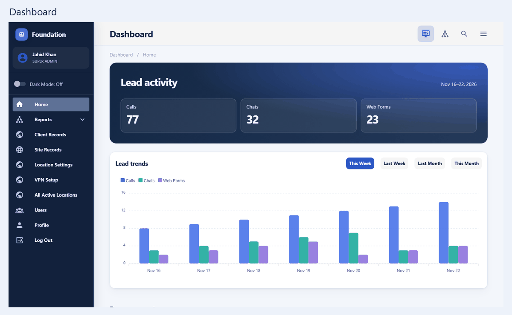

# lead-attribution-and-reporting-app

A Nuxt 2 and TypeScript dashboard for lead attribution, client and location administration, and website performance reporting. Maintained by Jahid Khan Tuhin, full stack JavaScript engineer.

## Showcase overview



## Run the local showcase

Use Node.js 22 and npm. From the repository root, run:

```powershell
npm ci --legacy-peer-deps
$env:NODE_OPTIONS = '--openssl-legacy-provider'
npx --no-install nuxt-ts dev
```

Open `http://localhost:3000`. Showcase mode is enabled by default. On Bash, use `NODE_OPTIONS=--openssl-legacy-provider npx --no-install nuxt-ts dev`. The OpenSSL option supports this repository’s Webpack 4 toolchain on current Node versions.

The showcase starts with a synthetic administrator and serves seeded records through an in-browser Axios adapter. It needs no API credentials, database, or OAuth account. The existing login, social callback, and password reset screens remain directly accessible. Authentication actions are simulated, so opening those pages, signing in, or signing out never removes access to the showcase. Client, location, staff, and user changes supported by the demo stay in browser memory and reset on refresh. Reports use synthetic numbers, call playback has no external recording, and report upload returns a local placeholder. VPN setup uses documentation-only IP addresses and has no effect on a server.

To build the static showcase, run `npx --no-install nuxt-ts generate` with the same Node options, then serve `dist/`. The build includes the seeded nested detail and edit links.

## Routes to showcase

| Area | Routes |
| --- | --- |
| Dashboard | `/` |
| Reports | `/reports`, `/reports/client-overview`, `/reports/lead-details-report`, `/reports/kpi`, `/reports/statistics`, `/reports/payment-report` |
| Client records | `/client-records`, `/client-records/add`, `/client-records/1`, `/client-records/1/edit` |
| Client locations | `/client-records/1/locations/add`, `/client-records/1/locations/1`, `/client-records/1/locations/1/edit` |
| Client staff | `/client-records/1/staff/add`, `/client-records/1/staff/1`, `/client-records/1/staff/1/edit` |
| Location administration | `/all-locations`, `/location-settings`, `/location-settings/add?id=5&name=Riverfront%20Intake` |
| Site records | `/site-records`, `/site-records/1` |
| Users and profile | `/users`, `/users/add`, `/users/2/edit`, `/profile` |
| VPN setup | `/vpn-setup` |
| Authentication screens | `/login`, `/social-login`, `/reset-password` |
| Utility routes | `/data-mining` redirects to Statistics, `/search` displays the existing placeholder, and `/404` and unknown paths display the existing error page. |

Start with Cedar Dental Studio at `/client-records/1` and follow its links to Cedar Downtown and Riley Chen. The report pages load sample filters automatically. Add forms keep their regular input fields and load their existing pickers with demo options.

## How it works

- `pages/` defines the Nuxt routes. Existing Vuetify templates continue to render API-shaped data via the same services, store, and report transforms.
- `plugins/showcase.ts` installs the sample session and routes shared Axios requests to the local adapter.
- `showcase/fixtures.ts` defines related clients, locations, staff, sites, users, and VPN entries. `showcase/reports.ts` supplies the different dashboard and report payload shapes. Existing client-overview examples informed the shape of the new synthetic data.
- `showcase/api.ts` handles lookups, report filters, pagination, and simulated form actions. An unrecognized request returns a local 404.

## Re-enable the original auth and API

Set the existing API URL for the environment and start or rebuild with `SHOWCASE_MODE=false`. For example, in PowerShell:

```powershell
$env:SHOWCASE_MODE = 'false'
$env:BASE_URL_DEVELOPMENT = 'http://localhost:8000/api/v1'
npx --no-install nuxt-ts dev
```

This restores the existing Nuxt Auth module with its Laravel Sanctum and Google strategies and sends Axios traffic to the configured backend. The matching backend and OAuth configuration are required for connected mode. Use `BASE_URL_PRODUCTION` for a production build and set the environment variables before running the build. To switch back, remove `SHOWCASE_MODE` or set it to `true`, then restart or rebuild.

## License

This project is licensed under the [MIT License](LICENSE).
